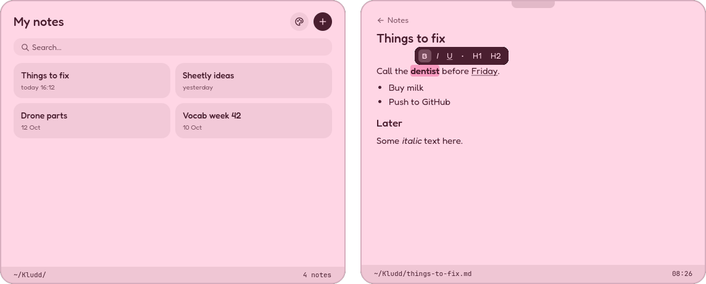

<h1 align="center">Kludd</h1>

<p align="center">
  <strong>A dead-fast, cute Markdown notepad that lives one keypress away in Hyprland.</strong>
</p>

<p align="center">
  
</p>

---

## What is Kludd?

Kludd starts once when you log in and waits in a Hyprland special workspace, so pressing <kbd>Home</kbd> shows it instantly: no startup, no loading. You write in rich text (bold, lists, headings) and every note is saved as a plain `.md` file in `~/Kludd`. Markdown that Kludd doesn't understand, like code blocks, tables and links, is kept exactly as you wrote it.

## Features

- **Instant** — Kludd keeps running in the background; the hotkey just toggles its workspace
- **Plain files** — one note is one `.md` file named after its title; no database, no index, no frontmatter
- **Rich text, real Markdown** — bold, italic, underline, bullets and headings while you type, saved as normal Markdown
- **Never mangles a note** — anything unsupported is shown as plain text and written back byte for byte (round-trip tested)
- **Autosave** — 400 ms after you stop typing and whenever Kludd hides, written atomically
- **Live reload** — edit a note in nvim and Kludd picks up the change
- **Any `.md` file** — `kludd notes.md` edits a file in place, and Kludd shows up in "Open with"
- **Six themes** — pink, yellow, mint, lavender, sky and dark, switched live from the palette button
- **Big notes stay smooth** — in the test suite a 5 000-line note loads in about 50 ms and a keystroke costs about 0.1 ms

## Install

### From source

```bash
# GTK 4, the status-bar font and a Rust toolchain (rustup works too)
sudo pacman -S --needed gtk4 ttf-jetbrains-mono rust

git clone https://github.com/loveranmar/kludd.git
cd kludd
./install.sh
```

`install.sh` builds a release binary and installs it into `~/.local` together with the desktop entry, the icon and the Fredoka font. `./install.sh --uninstall` removes it again and leaves your notes alone.

### Arch (AUR)

Kludd is not on the AUR yet. The PKGBUILD lives in [`packaging/`](packaging/PKGBUILD); once it is published, installing is `yay -S kludd`.

## Hyprland setup

Add this to your Hyprland config. It uses the block window rules of Hyprland 0.53 and newer:

```ini
# Start Kludd once, hidden in its own special workspace
exec-once = [workspace special:kludd silent] kludd --hidden

# Home shows and hides it
bind = , Home, togglespecialworkspace, kludd

# Kludd draws its own rounded border, so Hyprland's is switched off
windowrule {
    name = kludd
    match:class = ^(io\.github\.loveranmar\.Kludd)$
    workspace = special:kludd silent
    float = true
    center = true
    size = 560 460
    border_size = 0
    rounding = 0
    no_shadow = true
    no_blur = true
    no_dim = true
    opacity = 1.0 override 1.0 override
}
```

If you used `install.sh`, `~/.local/bin` may not be on Hyprland's `PATH`; write `~/.local/bin/kludd` as the full path (`/home/you/.local/bin/kludd`) in the `exec-once` line. When `special:kludd` opens, Kludd focuses itself through Hyprland's event socket, so you can start typing right away. Closing the window (say, your `killactive` bind) hides Kludd instead of quitting it, so <kbd>Home</kbd> stays instant; `kludd --quit` quits for real.

To open `.md` files with Kludd by default, run `xdg-mime default kludd.desktop text/markdown`.

## Keyboard shortcuts

| Keys | Action |
|------|--------|
| <kbd>Home</kbd> | Show or hide Kludd (the Hyprland bind above) |
| <kbd>Ctrl</kbd>+<kbd>N</kbd> | New note |
| <kbd>Ctrl</kbd>+<kbd>F</kbd> | Search notes (or just start typing on the notes view) |
| <kbd>Esc</kbd> | Back to the notes, or hide Kludd |
| <kbd>Ctrl</kbd>+<kbd>B</kbd> / <kbd>I</kbd> / <kbd>U</kbd> | Bold / italic / underline |
| <kbd>Ctrl</kbd>+<kbd>1</kbd> / <kbd>2</kbd> | Heading 1 / heading 2 |
| <kbd>Ctrl</kbd>+<kbd>0</kbd> | Normal text |
| <kbd>Ctrl</kbd>+<kbd>Shift</kbd>+<kbd>8</kbd> | Bullet list |
| <kbd>Tab</kbd> / <kbd>Shift</kbd>+<kbd>Tab</kbd> | Indent / outdent a bullet |
| <kbd>Ctrl</kbd>+<kbd>+</kbd> / <kbd>-</kbd> | Zoom the editor in / out |
| <kbd>Ctrl</kbd>+<kbd>Shift</kbd>+<kbd>0</kbd> | Reset zoom |
| <kbd>Ctrl</kbd>+<kbd>Z</kbd> / <kbd>Ctrl</kbd>+<kbd>Shift</kbd>+<kbd>Z</kbd> | Undo / redo (formatting included) |

Typing `- ` or `* ` at the start of a line makes a bullet, `# ` and `## ` make headings, and Enter on an empty bullet ends the list. Select text to get the floating **B** *I* <u>U</u> • H1 H2 toolbar.

From a terminal, `kludd` shows the running Kludd, `kludd file.md` opens a file in it, and `kludd --quit` saves and quits.

## Configuration

`~/.config/kludd/config.toml` is created when you first change the theme or zoom:

```toml
notes_dir = "~/Kludd"  # where notes live
theme = "pink"         # pink, yellow, mint, lavender, sky or dark
zoom = 1.0             # editor zoom, changed with Ctrl +/-
```

## How notes are stored

Every note is a single Markdown file in `notes_dir`, and nothing else is written there. The title is the note's first `# Heading`, and the file is named after it: *Things to fix* becomes `things-to-fix.md`. Change the title and the file is renamed with it (`-2`, `-3` and so on if the name is taken).

| In the editor | In the file |
|---------------|-------------|
| **Bold** | `**text**` |
| *Italic* | `*text*` |
| <u>Underline</u> | `<u>text</u>` |
| Bullet | `- text`, two spaces per level |
| Heading 1 / 2 | `# ` / `## ` |

Files opened from elsewhere are edited where they are and are never renamed. Deleting a note (right-click its card) moves it to the trash.

## License

[MIT](LICENSE): use, change and share Kludd freely; just keep the copyright notice. Kludd bundles the [Fredoka](https://github.com/hafontia/Fredoka-One) font ([OFL 1.1](assets/fonts/OFL.txt)) and four [Tabler Icons](https://tabler.io/icons) ([MIT](assets/icons/LICENSE-tabler)). Contributions are welcome, see [CONTRIBUTING.md](CONTRIBUTING.md).

---

<p align="center">
  Built by <a href="https://github.com/loveranmar">@loveranmar</a>
</p>
